# Single-Phase Transformer Simulation

Electromagnetic simulation exercises in Ansys Maxwell 2D/3D, scripted end to end with PyAEDT, as groundwork for modeling a single-phase transformer.

Each exercise builds and solves a model from a Jupyter notebook. For most of them I also wrote a separate analysis notebook that checks the result against a closed-form formula or a simple physical model. When the two didn't agree, I tried to find out why instead of just accepting the number. Several of those gaps turned out to be modeling or measurement artifacts, and a couple turned out to be real physics.

The transformer model itself is the next step and is still in progress (see [Transformer model](#transformer-model-in-progress)).

## Highlights

**Torque dip at 90° and 270° is geometry, not mesh** ([Week1_ex1](Examples/Week1/Week1_ex1/Week1_ex1_angle_sweep_analysis.ipynb))
A rotating coil next to a permanent magnet should give a sin θ torque curve, but the sweep showed sharp dips at 90° and 270°. Re-solving 90° with twice the mesh changed the torque by only 0.1 µN·m, so convergence was ruled out. Top-view field plots showed that the coil becomes symmetric with the magnet at those angles, and the torque from its two halves partly cancels. A uniform-field sin θ model can't capture that.

**A force curve that bends for a real reason** ([Week1_ex2](Examples/Week1/Week1_ex2/Week1_ex2_analysis.ipynb))
A C-core actuator with a magnet bias should give a smooth parabola in current, but the force stayed near zero up to about 100 A and then rose quickly. A simple reluctance circuit was 12× off, and re-solving every point with its own mesh made the kink sharper, not smaller. Two field probes then showed that at 0 A over 98% of the magnet's flux circulates in an all-steel loop that is already near 1.17 T. As the coil current rises, it pushes more of that flux out through the air gap (the gap/loop ratio grows from 0.0145 to 0.0857). So the kink is a two-path magnetic circuit near saturation, not an error in the model.

**Two separate artifacts in one straight-wire field plot** ([Week2_ex1](Examples/Week2/Week2_ex1/Week2_ex1_analysis.ipynb))
The H-field around a straight wire showed a +4.30% / −7.59% sawtooth right at the wire surface and a −21% error at the far end of the probe line. The first came from the 12-sided wire cross-section: with 36 sides it dropped to +0.94% / −0.51%. The second came from the probe line ending exactly on the radiation boundary: tripling the region size brought it from −21.46% to −0.21%. Neither was a real field effect.

**A normal force that shouldn't exist** ([Week5_ex2](Examples/Week5/Week5_ex2/Week5_ex2_analysis.ipynb))
In a 1-slot linear motor, symmetry says the normal force on the coil is zero, but the solver reported about a quarter of the thrust. A companion run computed the Lorentz force and the virtual force side by side in the same solve. The Lorentz force showed almost no normal component, and its thrust (4.98 N) matched a 3D charge model to 0.2%. The extra force came from using virtual force on non-magnetic objects (copper coil and an air slot), which even reported a force on the air region.

## Environment and license limits

- Ansys Electronics Desktop 2025 R2 (Student), Maxwell 2D/3D
- PyAEDT 0.15.3 (pinned), Python 3.12, Jupyter, Windows

The Student license shaped a lot of the work:

- **No Transient solver.** When motion isn't the point of the exercise, I replaced time with a design variable (`t_sample`, rotor angle, gap, current) and swept it with Magnetostatic. Eddy-current braking (Week5_ex4, ex5) really needs motion, so those notebooks are kept as documented limitations, with a full-license version next to the Student one.
- **Mesh caps** (64,000 elements in 3D, only 2,000 in 2D). The 4-pole 3-slot IPM machine in Week6_ex3 can't fit under the 2D cap, and with no common divisor between poles and slots there's no symmetry to cut the model with.
- **PyAEDT wrapper issues.** In 2025 R2 the EddyCurrent solver is called "AC Magnetic" internally, and several PyAEDT 0.15.3 helpers fail on it (`create_setup`, `assign_radiation`, `get_solution_data`). Those notebooks call the AEDT API directly instead. Optimetrics sweeps also didn't keep force results per point, so force sweeps run as plain Python loops.

## How the repository is organized

```
Examples/
└── WeekN/
    └── WeekN_exM/
        ├── WeekN_exM.ipynb            builds and solves the model in AEDT (outputs cleared)
        ├── WeekN_exM_analysis.ipynb   compares the result with theory (no AEDT, outputs kept)
        ├── WeekN_exM_<purpose>.ipynb  companion run to test a hypothesis (outputs cleared)
        ├── WeekN_exM_<content>.csv    data exported by the original notebook
        └── Images/                    model screenshot and plots
```

When a few exercises use the same model with small changes, one analysis notebook covers all of them and is named with a range, for example `Week2_ex3_to_5_analysis.ipynb`.

The analysis notebooks don't need AEDT, so they can be read directly on GitHub. Values that came from the AEDT GUI are typed into the notebook, and the comment above them says where they were read.

## Exercises

**Check types**
- *Deep dive*: the result disagreed with theory, so I made hypotheses and tested them, sometimes with a companion run.
- *Light check*: the result was compared with a closed form or a simple model and agreed within the expected range.
- *Cross-check*: no separate analysis; the data is used to support another exercise's analysis.
- *Known limitation*: can't be solved on the Student license; the notebook explains why.

### Week 1 – Forces, torque and eddy currents

| | Exercise | Check | Result |
|---|---|---|---|
| 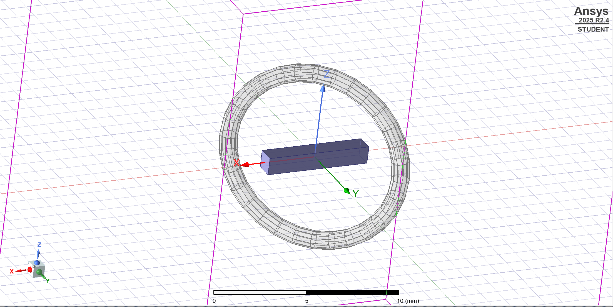 | [Week1_ex1](Examples/Week1/Week1_ex1) Torque on a rotated permanent magnet | Deep dive ([1](Examples/Week1/Week1_ex1/Week1_ex1_analysis.ipynb), [2](Examples/Week1/Week1_ex1/Week1_ex1_angle_sweep_analysis.ipynb)) | 28.3 µN·m at 45°. Angle sweep dips at 90°/270° come from coil–magnet symmetry, not the mesh. |
| 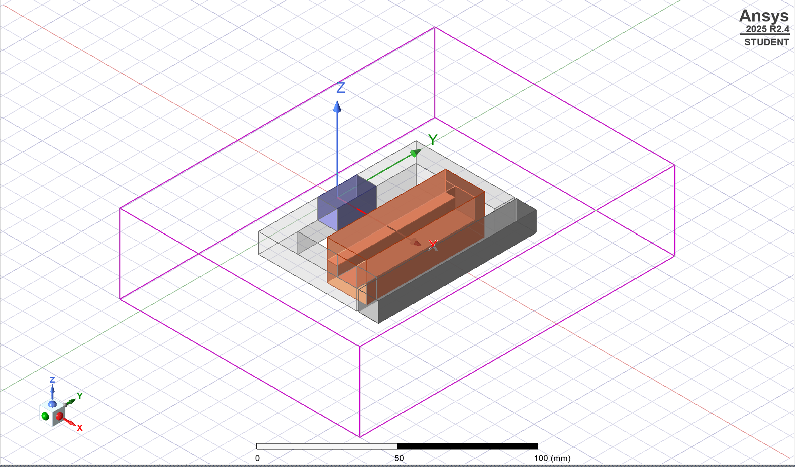 | [Week1_ex2](Examples/Week1/Week1_ex2) Force sweep on a C-core electromagnet | [Deep dive](Examples/Week1/Week1_ex2/Week1_ex2_analysis.ipynb) | The kink near 100 A is real. The magnet's flux splits between the steel loop and the air gap, and the split shifts as the core nears saturation. |
| 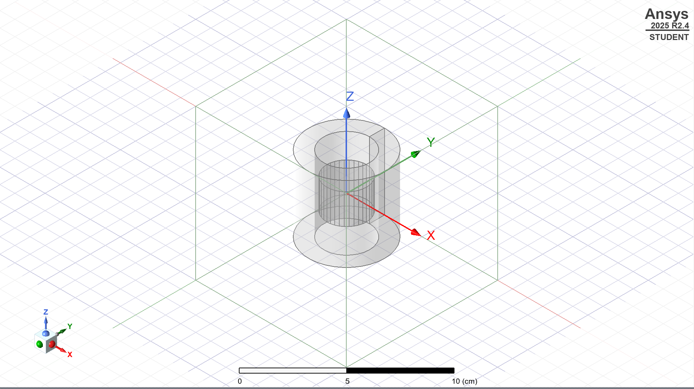 | [Week1_ex3](Examples/Week1/Week1_ex3) Force vs. magnet position | [Deep dive](Examples/Week1/Week1_ex3/Week1_ex3_analysis.ipynb) | The ~4 N swing in Force_z comes from the magnet getting within 3.5 cm of the region wall. |
| 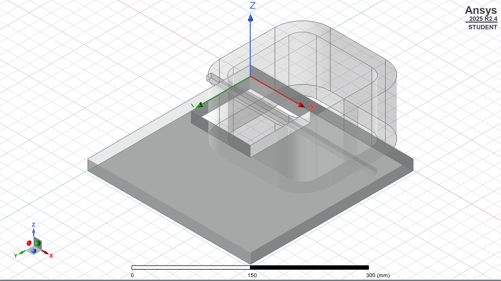 | [Week1_ex4](Examples/Week1/Week1_ex4) Eddy currents in an aluminum plate | [Light check](Examples/Week1/Week1_ex4/Week1_ex4_analysis.ipynb) | Skin depth 5.8 mm in a 19 mm plate, so the current concentrates near both faces. |
| 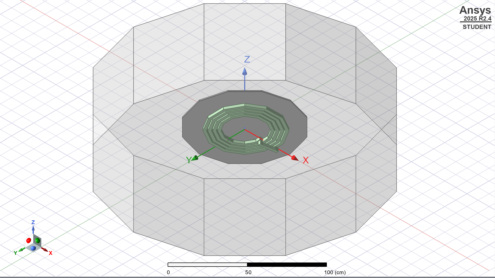 | [Week1_ex5](Examples/Week1/Week1_ex5) Induction heating of a disk | [Light check](Examples/Week1/Week1_ex5/Week1_ex5_analysis.ipynb) | Cast iron 65.9 W, stainless 51.7 W, ferrite ~0 W. Only cast iron is limited by skin depth. |

### Week 2 – Field around a straight wire

| | Exercise | Check | Result |
|---|---|---|---|
| 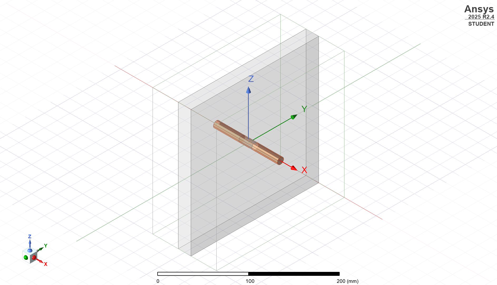 | [Week2_ex1](Examples/Week2/Week2_ex1) Straight wire H-field | [Deep dive](Examples/Week2/Week2_ex1/Week2_ex1_analysis.ipynb) | Surface sawtooth from the 12-sided wire, far-end error from the radiation boundary. Both fixed by changing the model, not the solver. |
|  | [Week2_ex2](Examples/Week2/Week2_ex2) Straight wire B-field | Cross-check | Same error pattern as Week2_ex1. Used as supporting data there (Section 8). |
| 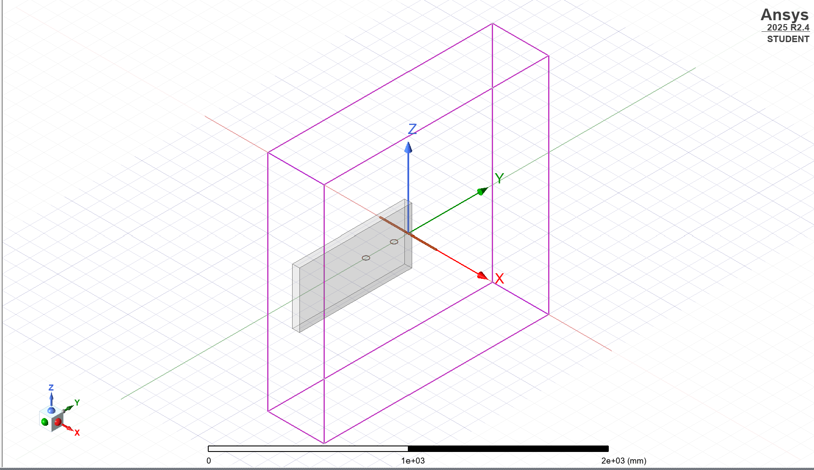 | [Week2_ex3](Examples/Week2/Week2_ex3) Ring coils beside a wire, H | [Light check](Examples/Week2/Week2_ex3/Week2_ex3_to_5_analysis.ipynb) | Disk-averaged H within 0.4% of the closed form at 100 mm and 300 mm. |
|  | [Week2_ex4](Examples/Week2/Week2_ex4) Ring coils beside a wire, B | [Light check](Examples/Week2/Week2_ex3/Week2_ex3_to_5_analysis.ipynb) | Same model as ex3. B equals μ0·H within 2 ppm. |
| 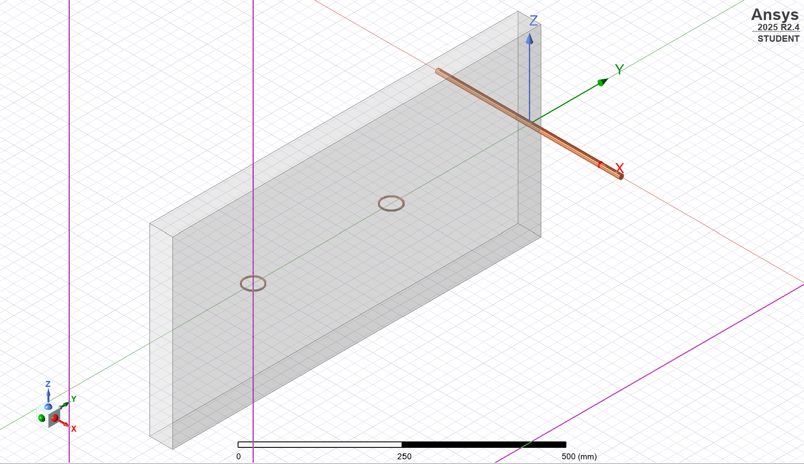 | [Week2_ex5](Examples/Week2/Week2_ex5) Flux through the rings | [Light check](Examples/Week2/Week2_ex3/Week2_ex3_to_5_analysis.ipynb) | The meshed disk is a 24-gon (1.14% less area). The ring 200 mm from the boundary reads 6.4% low. |

### Week 3 – Flux linkage and induction

| | Exercise | Check | Result |
|---|---|---|---|
| 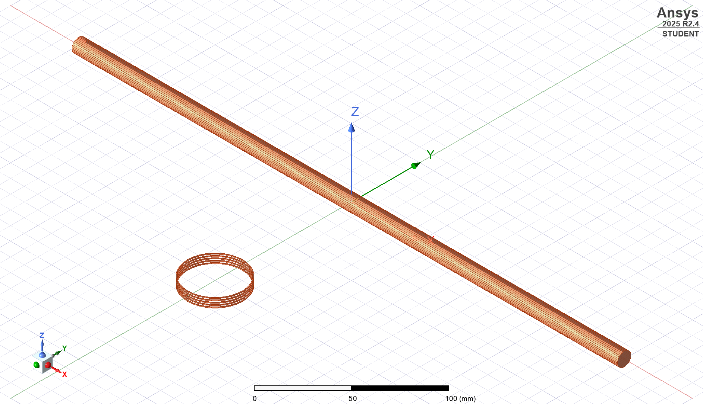 | [Week3_ex1](Examples/Week3/Week3_ex1) 5-turn coil beside a wire | [Light check](Examples/Week3/Week3_ex1/Week3_ex1_analysis.ipynb) | +0.03% once the theory uses the 36-sided ring and averages over the conductor width. |
| 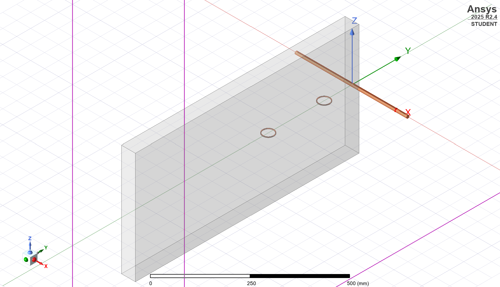 | [Week3_ex2](Examples/Week3/Week3_ex2) Closed rings in an AC field | [Light check](Examples/Week3/Week3_ex2/Week3_ex2_analysis.ipynb) | Within 0.4% after the area correction. The 90° phase part is the rings' own eddy-current reaction. |
| 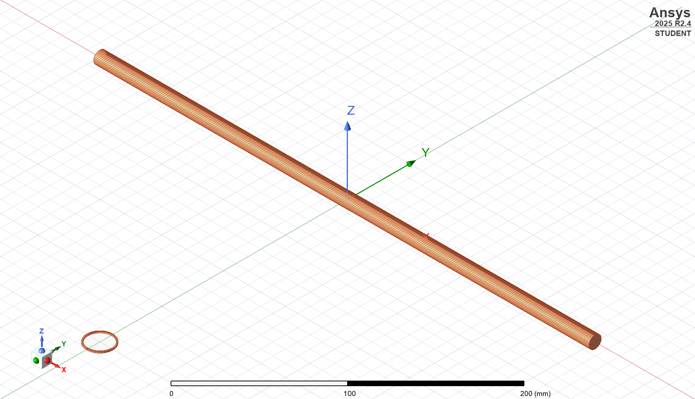 | [Week3_ex3](Examples/Week3/Week3_ex3) Induced voltage in a ring | [Light check](Examples/Week3/Week3_ex3/Week3_ex3_to_4_analysis.ipynb) | Faraday's law closes to +0.25% inside the solution. |
| 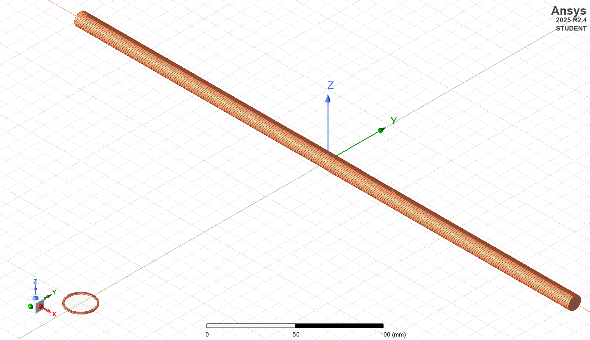 | [Week3_ex4](Examples/Week3/Week3_ex4) Induced current in a ring | [Light check](Examples/Week3/Week3_ex3/Week3_ex3_to_4_analysis.ipynb) | The ring acts like an R-L loop: L ≈ 41 nH from the current phase vs. 40 nH from the formula. |
| 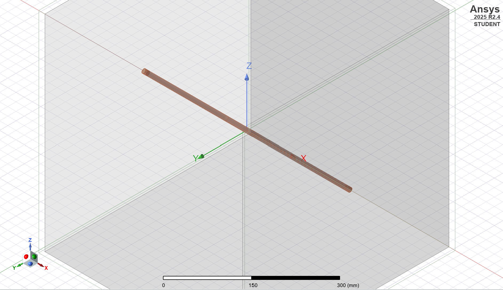 | [Week3_ex5](Examples/Week3/Week3_ex5) Wire in a uniform 1 T field | [Light check](Examples/Week3/Week3_ex5/Week3_ex5_analysis.ipynb) | 10.0012 N vs. B·I·L = 10 N (+0.012%). |

### Week 4 – Cores, wire forces and a simple DC machine

| | Exercise | Check | Result |
|---|---|---|---|
| 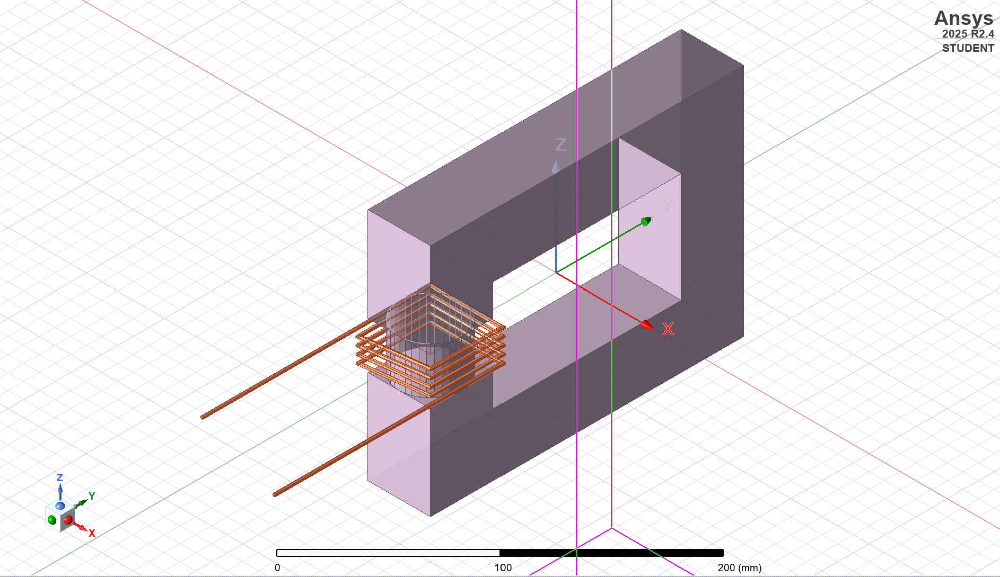 | [Week4_ex1](Examples/Week4/Week4_ex1) Induction heating core, stainless | [Light check](Examples/Week4/Week4_ex1/Week4_ex1_to_2_analysis.ipynb) | Mean field matches Biot-Savart to +0.01%. |
| 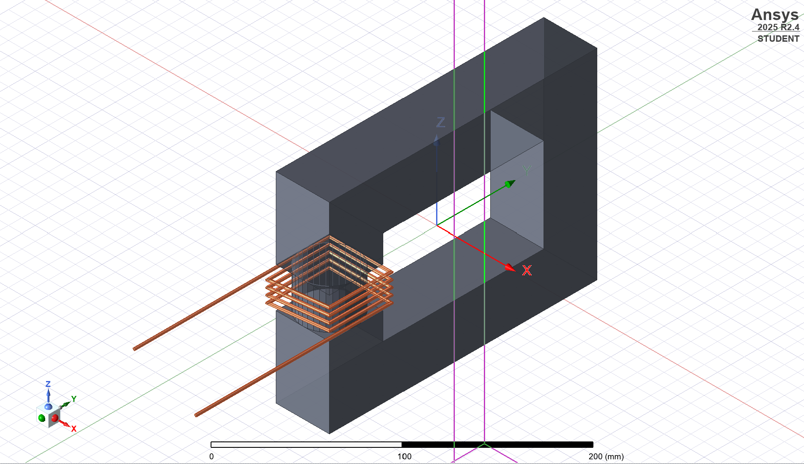 | [Week4_ex2](Examples/Week4/Week4_ex2) Induction heating core, ferrite | [Light check](Examples/Week4/Week4_ex1/Week4_ex1_to_2_analysis.ipynb) | Field rises about 160× to 1.79 T, between the 1.47–2.07 T magnetic-circuit bounds (linear μr, no saturation). |
| 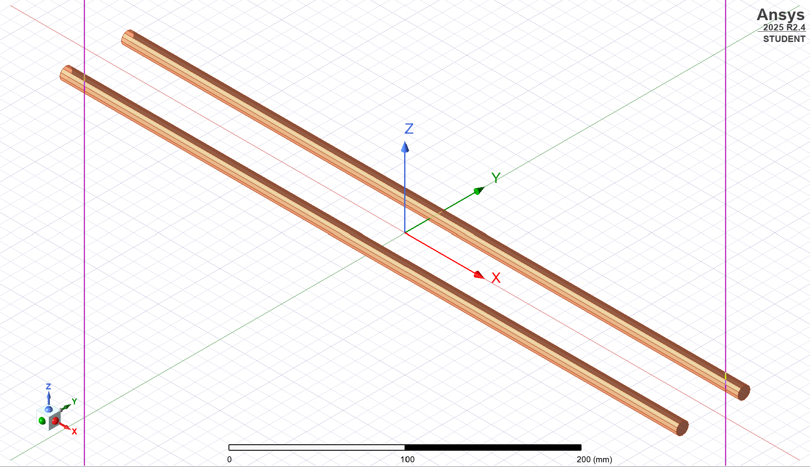 | [Week4_ex3](Examples/Week4/Week4_ex3) Force between parallel wires | [Light check](Examples/Week4/Week4_ex3/Week4_ex3_to_4_analysis.ipynb) | Within +0.2–0.5% of μ0I²L/(2πd). |
| 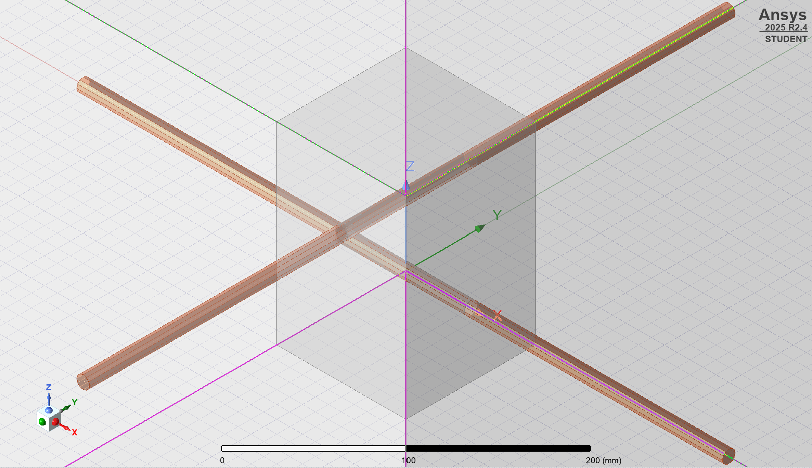 | [Week4_ex4](Examples/Week4/Week4_ex4) Force between crossed wires | [Light check](Examples/Week4/Week4_ex3/Week4_ex3_to_4_analysis.ipynb) | Field 50% high at the line ends because of the region walls. A model with walls matches within ~3%. |
| 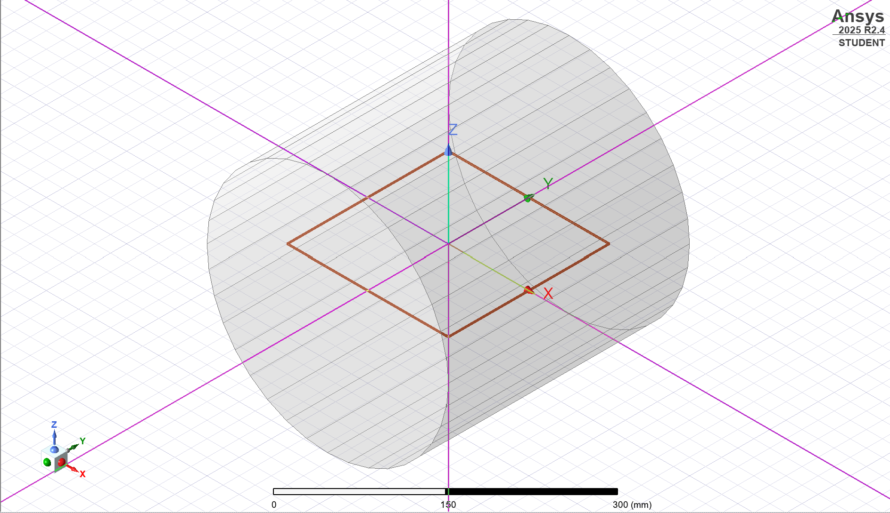 | [Week4_ex5](Examples/Week4/Week4_ex5) Simple DC machine | [Light check](Examples/Week4/Week4_ex5/Week4_ex5_analysis.ipynb) | Torque within 0.11% of NIAB. Torque and back-EMF give the same machine constant (k_T/k_E = 0.9989). The leftover +0.8 mWb flux offset is the coil's own L·I. |

### Week 5 – Permanent magnets and linear motors

| | Exercise | Check | Result |
|---|---|---|---|
| 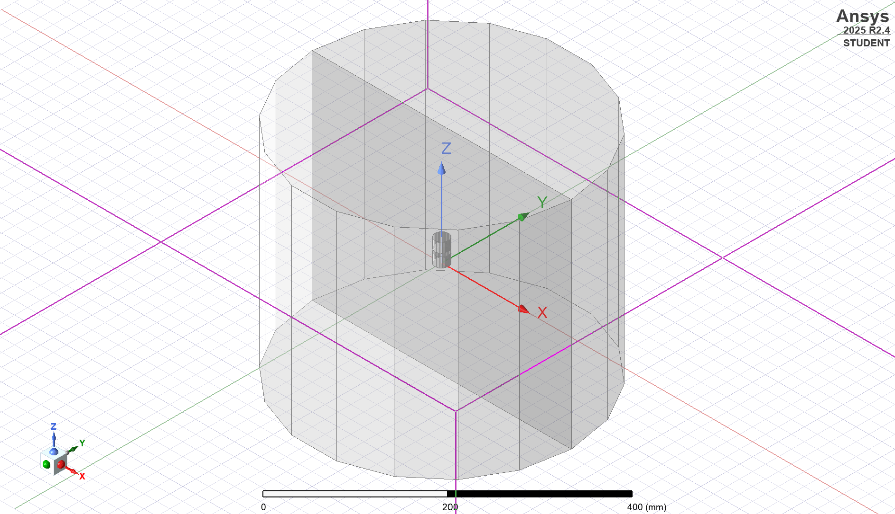 | [Week5_ex1](Examples/Week5/Week5_ex1) Force between two magnets | [Light check](Examples/Week5/Week5_ex1/Week5_ex1_analysis.ipynb) | 46.8 N. A rigid-magnet model was 7% high; including the magnets' recoil permeability brings it within 1%. |
| 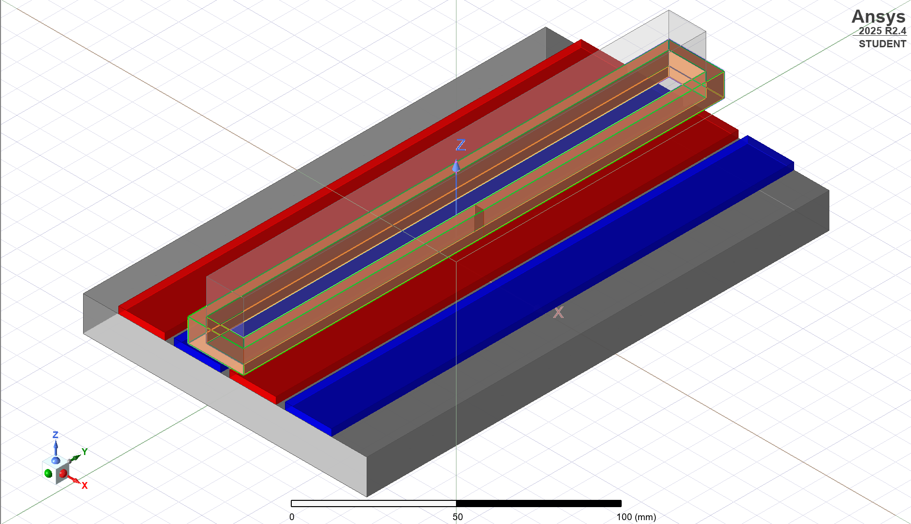 | [Week5_ex2](Examples/Week5/Week5_ex2) Linear motor, 1 slot | [Deep dive](Examples/Week5/Week5_ex2/Week5_ex2_analysis.ipynb) | Normal force is a virtual-force artifact. Lorentz thrust 4.98 N, within 0.2% of the model. |
| 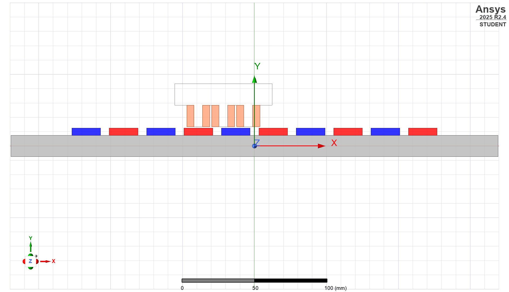 | [Week5_ex3](Examples/Week5/Week5_ex3) Linear motor, pulsating current | [Light check](Examples/Week5/Week5_ex3/Week5_ex3_analysis.ipynb) | Force is linear in current (K_y = −0.86 N/A). Found and fixed a mA/A export bug. |
| – | [Week5_ex4](Examples/Week5/Week5_ex4) Eddy current braking | Known limitation | Needs Transient with motion. Full-license version included. |
| – | [Week5_ex5](Examples/Week5/Week5_ex5) Eddy current braking, speed sweep | Known limitation | Same reason as ex4. Full-license version included. |

### Week 6 – Motors and magnet forces

| | Exercise | Check | Result |
|---|---|---|---|
| 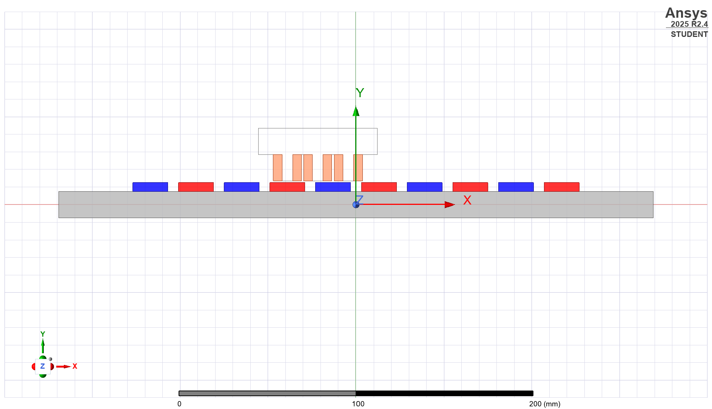 | [Week6_ex1](Examples/Week6/Week6_ex1) 3-slot linear motor, fixed mover | [Light check](Examples/Week6/Week6_ex1/Week6_ex1_to_2_analysis.ipynb) | Same motor as Week5_ex3 with a finer mesh. The zero-current offset drops from −0.070 N to +0.0009 N. |
| 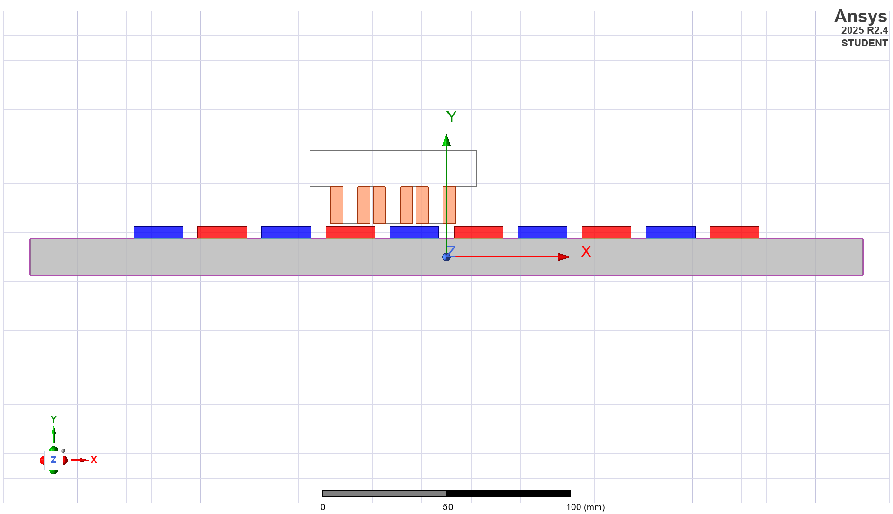 | [Week6_ex2](Examples/Week6/Week6_ex2) 3-slot linear motor, moving mover | [Light check](Examples/Week6/Week6_ex1/Week6_ex1_to_2_analysis.ipynb) | Thrust pulses at twice the current frequency with a mean of 1.09 N. A charge model follows it within ~1%. |
| – | [Week6_ex3](Examples/Week6/Week6_ex3) 4-pole 3-slot IPM machine | Known limitation | Exceeds the 2D mesh cap, and 4 poles / 3 slots leave no symmetry to use. |
| 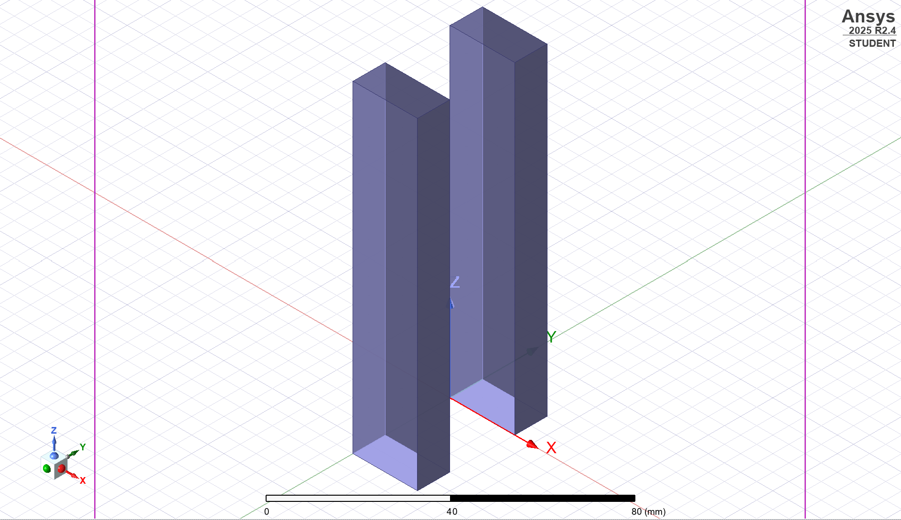 | [Week6_ex4](Examples/Week6/Week6_ex4) Two block magnets vs. gap | [Light check](Examples/Week6/Week6_ex4/Week6_ex4_analysis.ipynb) | 326.5 N at 2 mm down to 44.3 N at 20 mm. Charge model within 0.1–0.7% (1.6% at 2 mm). |
| 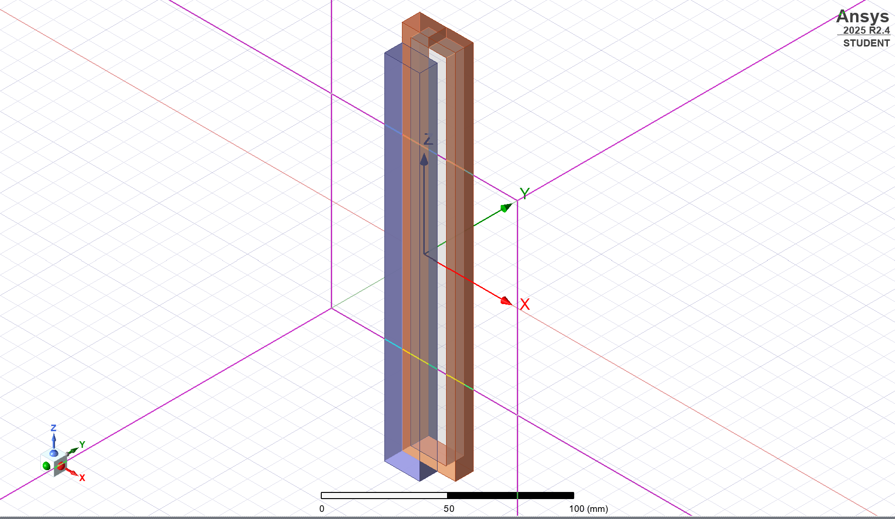 | [Week6_ex5](Examples/Week6/Week6_ex5) Air-core coil and a magnet | [Light check](Examples/Week6/Week6_ex5/Week6_ex5_analysis.ipynb) | Force is linear in current, 0.0404 N/A vs. 0.0411 N/A from the model (+1.6%). |

## Transformer model (in progress)

The next part of this repository is a single-phase transformer modeled in Maxwell, followed by a small physical build from ordered parts. This section will be filled in as that work is done.

## Running the notebooks

1. Install Ansys Electronics Desktop 2025 R2 (the Student version works for everything except the Known limitation exercises).
2. Create a Python 3.12 environment and install PyAEDT: `pip install pyaedt==0.15.3`
3. Optionally set `ANSYS_PROJECT_DIR` to choose where AEDT projects are saved. Each notebook creates a subfolder named after the exercise there. If it isn't set, that subfolder is created next to the notebook.
4. Run an exercise notebook top to bottom.

The analysis notebooks only need `numpy`, `pandas` and `matplotlib` (`scipy` for Week5_ex1).
